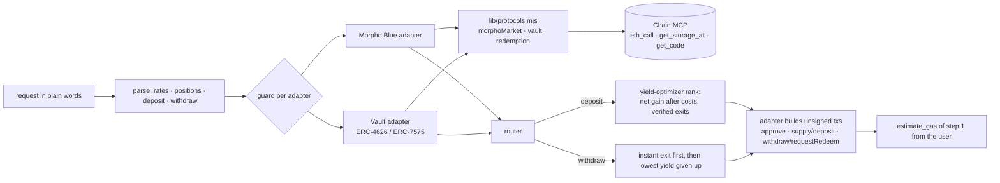

# Multi-Protocol Aggregator

One interface over Morpho Blue and the four tokenized vaults on Pharos mainnet: ask for rates or positions, or ask to
deposit or withdraw, and it routes the request to the best venue across protocols, says why, and prepares the
transactions for signature. One protocol failing does not stop the others.

```bash
node multi-protocol-aggregator/agg.mjs --user 0x… "rates for USDC" "positions" "deposit 5000 USDC" "withdraw 1000 USDC"
node multi-protocol-aggregator/agg.mjs --user 0x… --down morpho "deposit 5000 USDC"     # make Morpho unavailable
```

## Architecture



- **Adapters** ([`adapters.mjs`](adapters.mjs)) share one shape: `venues(asset)`, `positions(user)`,
  `deposit(user, venue, amount)`, `withdraw(user, venue, amount)` → unsigned `{ to, data }`. Adding a protocol means
  adding an adapter; the router does not change.
- **Guard**: every adapter call goes through it. An error (or `--down`) marks that protocol unavailable for the run,
  prints a warning, and every request is answered from the protocols that are still up.
- **Router**: deposits use the yield optimizer's ranking (30-day net gain after fees and gas; exits must be verifiable
  on chain; Morpho yields diluted by the deposit). Withdrawals pick a position big enough, prefer an instant exit
  (Morpho within its liquidity; a vault that redeems synchronously *and* holds the asset), then the lowest yield given up.
  When the only way out is not instant, it is still prepared, with a warning and the simulation's reason.
- **Transactions**: unsigned calldata; step 1 is simulated from the user with `estimate_gas`, and a revert is decoded
  (`AccessControlUnauthorizedAccount`, `ERC20InsufficientBalance`, …). No key anywhere.

## Demo on mainnet, 2026-10-20

User `0x0be2…94e7`, the holder of 4.99M shares of the RPC-AKU vault.

[`demo-run.txt`](demo-run.txt), all protocols up (block 20,742,098):

| Request | Result |
|---|---|
| rates for USDC | 13 venues across both protocols, each with its exit mode and source (vault APYs 9.29–13.50%, Morpho 0–7.78%) |
| positions | 5,035,547 USDC in the RPC-AKU vault, earning 13.50% |
| deposit 5000 USDC | → **Morpho wsrUSD/USDC**, 5.46%, ≈ $22.42 in 30 days, instant exit. The vaults pay more but none has a verifiable exit; the next Morpho markets pay less. approve + supply prepared; approve simulates |
| withdraw 1000 USDC | → RPC-AKU vault (the only position), **flagged not instant**: the vault holds 0 USDC on chain; the prepared `withdraw` reverts in simulation with `AccessControlUnauthorizedAccount` — even its holder cannot withdraw directly |
| borrow 10 USDC | not supported: says so and lists what it can do |

[`demo-down-morpho.txt`](demo-down-morpho.txt), Morpho made unavailable with `--down morpho`: rates come from the vaults
only, with a warning; the deposit is **not routed** and each vault is listed with why (exit not verifiable); the
withdrawal still works on the vault side.

[`demo-real-outage.txt`](demo-real-outage.txt), a real outage: during one run the Chain MCP endpoint answered a vault read
with an HTML error page. The vault adapter was marked unavailable and the run continued on Morpho: rates, the deposit
route and its transactions came out; positions and the withdrawal said they could not see the vault side.

| Requirement | Where |
|---|---|
| ≥ 2 protocols or vaults behind one interface | Morpho Blue (15 markets) + 4 vaults, one `agg.mjs` |
| Queries and actions (deposit/withdraw prepared for signature) | rates, positions; deposit, withdraw → unsigned txs |
| Routes each request to the best venue and explains why | route line + "not X: …" lines |
| One protocol unavailable without breaking the others | guard; `--down morpho`; the real outage run |
| Architecture write-up and demo video | this page; the video is recorded separately |

Limits: assets USDC and WPROS; positions are vault shares and Morpho supply (borrowing is out of scope).
