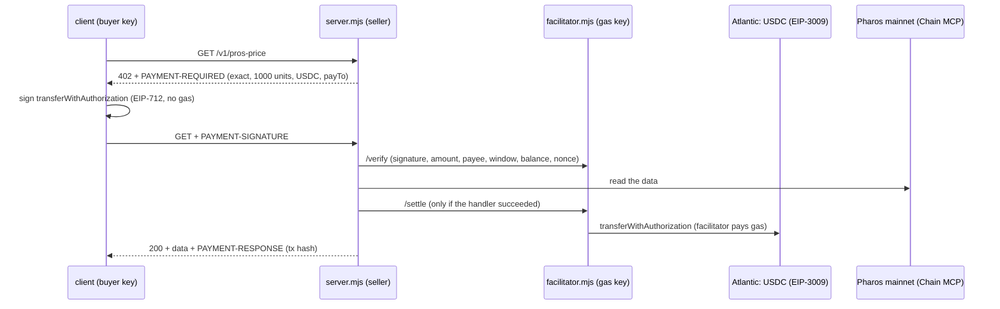

# x402 Paywalled API

An API that charges per request with x402 on **Pharos Atlantic Testnet** (`eip155:688689`), in test USDC, with its
own facilitator. What it sells is real: live **Pharos mainnet** data read through Chain MCP with the libraries the
other builds in this repo use (Chainlink feed, the V3 pool, Morpho Blue).

| Route | Price | Returns |
|---|---|---|
| `GET /health` | free | status, network, payee, asset, facilitator |
| `GET /catalog` | free | routes and prices (what an agent reads before buying) |
| `GET /v1/pros-price` | $0.001 | PROS/USD from the Chainlink feed, with its age, contract and block |
| `GET /v1/pool/wpros-usdc` | $0.002 | WPROS/USDC 0.01% pool: price, in-range liquidity, the price at both range edges, reserves |
| `GET /v1/morpho/:address` | $0.005 | that address's Morpho Blue positions across 15 markets, health factor of each borrow |

```bash
# keys in .env.atlantic (git-ignored): BUYER_/FACILITATOR_/SELLER_PRIVATE_KEY and _ADDRESS
node --env-file=.env.atlantic x402-paywalled-api/facilitator.mjs   # :4020  /verify /settle /supported /health
node --env-file=.env.atlantic x402-paywalled-api/server.mjs        # :4021  the API
node --env-file=.env.atlantic x402-paywalled-api/demo.mjs          # the full flow + refused payments, checked on chain
```

## How it works



- [`server.mjs`](server.mjs): `@x402/express` payment middleware, prices in USD converted to USDC units by a money
  parser (`usdcUnits`, string arithmetic, no float rounding). A handler that fails answers 4xx/5xx and the middleware
  **cancels the settlement**: no data, no charge (this happened for real, see the buyer's README).
- [`facilitator.mjs`](facilitator.mjs): our own facilitator (`@x402/core` + `@x402/evm` exact scheme) on a viem wallet
  for Atlantic; `/verify`, `/settle`, `/supported`, plus `/health` with its gas balance. Every call is appended to
  [`facilitator-log.jsonl`](facilitator-log.jsonl).
- Keys are only in `.env.atlantic` (git-ignored, three wallets generated for this build); code reads them from the
  environment. A scan of every file in both x402 folders for the three keys finds none.

## Which test USDC: the docs' one can't be used

The x402 Atlantic page says to use `0xE0BE08c7…64ec8` ("not an official address"). On chain it has **no EIP-3009**
(`transferWithAuthorization` / `receiveWithAuthorization` / `authorizationState` selectors absent), no `permit`, EIP-712
name `USD Coin` and no `version()` — while the same page's server code declares `name: "USDC", version: "2"`. An x402
"exact" payment in it cannot be settled. Circle's test USDC from the Token Registry, `0xcfC8330f…Fc8B` (a FiatToken
proxy; implementation `0x02c3fe2d…6126` has all three EIP-3009 functions), has name `USDC`, version `2`, 6 decimals.
That is the one used here, from the Circle faucet.

Also: the 2.28 client SDK only pays in tokens it knows by default (`spendControls`); Circle's Atlantic USDC has to be
allowed explicitly (`setSpendControls({ allowedAssets: [{ network, asset, maxAmountPerPayment }] })`).

## Demo, 2026-10-20 ([`runs/demo.txt`](runs/demo.txt)) — 11 checks, all passed

1. `GET /health` → **200** without payment.
2. `GET /v1/pros-price` → **402**; `PAYMENT-REQUIRED` decoded: `exact`, `eip155:688689`, amount `1000` (0.001 USDC),
   asset `0xcfC8…`, payTo the seller, extra `{name: USDC, version: 2}`. The client signs an EIP-3009 authorization
   (the buyer pays no gas) and sends `PAYMENT-SIGNATURE` → **200** with the data and `PAYMENT-RESPONSE`: success, tx
   [`0x8f8dd658…27d8`](https://atlantic.pharosscan.xyz/tx/0x8f8dd658e621b1ee66b0e06a6c73f3b150f5dcb9490aacc4989bd32081cf27d8).
   Checked on chain by the demo itself (not the facilitator's word): receipt success, USDC `Transfer` buyer → seller of
   exactly 0.001.
3. `GET /v1/pool/wpros-usdc`, the second paid route at another price: 402 (2000 units) → pay → **200**, tx
   [`0x62c219aa…f9c`](https://atlantic.pharosscan.xyz/tx/0x62c219aafb981cb82678785b28e4219cd17afdd1db9c3148404fce2d9ca09f9c),
   Transfer of exactly 0.002.
4. **Underpaid** (signed for half the price) → **402** `No matching payment requirements`.
5. **Bad signature** (one byte changed) → **402** `invalid_exact_evm_signature`.
6. **Replay** of the payment settled in step 2 → **402** `invalid_exact_evm_nonce_already_used`.
7. Balances: buyer −0.003, seller +0.003 — only the two good payments moved money.

The run before it stopped after its first payment
([`0x1b67fcf8…4db9`](https://atlantic.pharosscan.xyz/tx/0x1b67fcf8be64ed181865680e6ff93d6c016ca3c0402de9afcfb2bcf793684db9),
0.001, settled) because the demo's own on-chain check choked on USDC's `AuthorizationUsed` log; that is why the run
above starts with the seller at 0.001. The facilitator's side of both runs is in [`facilitator-log.jsonl`](facilitator-log.jsonl)
and [`runs/facilitator-console.txt`](runs/facilitator-console.txt).

| Requirement | Where |
|---|---|
| Runs on Atlantic Testnet (eip155:688689), priced in test USDC | `config.mjs`; every 402 above |
| ≥ 2 paid routes at different prices and 1 free route | $0.001, $0.002, $0.005; `/health`, `/catalog` |
| Own facilitator with /verify, /settle, /supported | `facilitator.mjs` on :4020 |
| Demo: 402, then a signed payment, then 200 with PAYMENT-RESPONSE and its tx hash on the explorer | steps 2–3, links above |
| Rejects a bad or underpaid payment with another 402 | steps 4–6 (underpaid, forged, replayed) |
| Private keys in env vars or a file, never in code or prompts | `.env.atlantic`, generated locally, never printed |

Limits: runs on localhost (the demo and the explorer links are the proof); the facilitator settles synchronously from
one wallet. The buyer agent that pays these routes within a budget is [`x402-agent-buyer/`](../x402-agent-buyer/).

Tests: `npm test` (`test/x402.test.mjs`: USD → USDC units).
